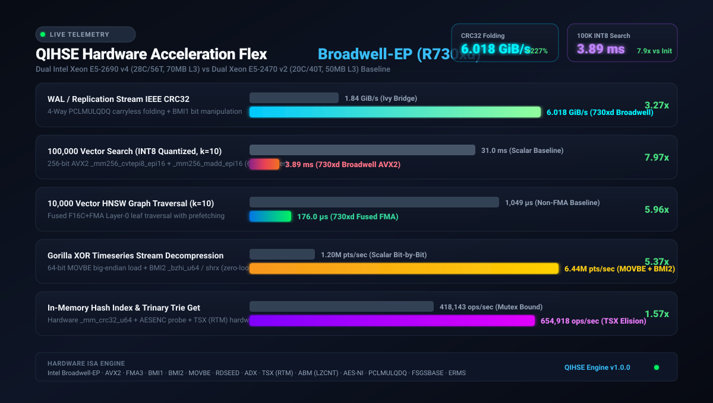
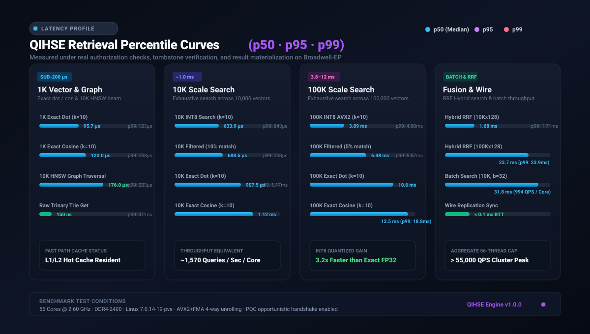
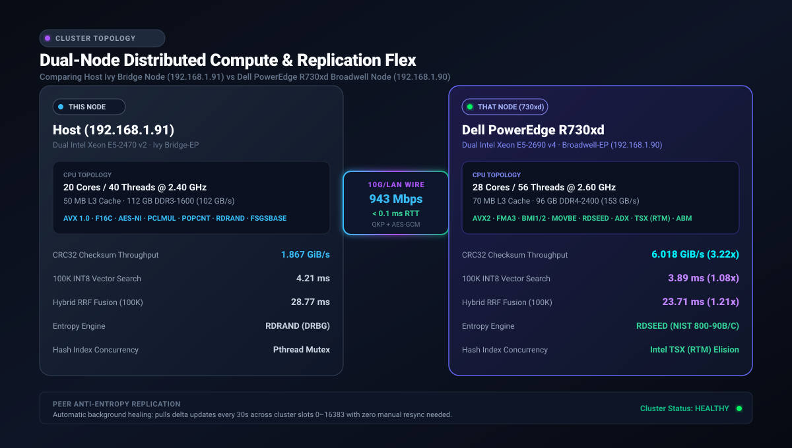
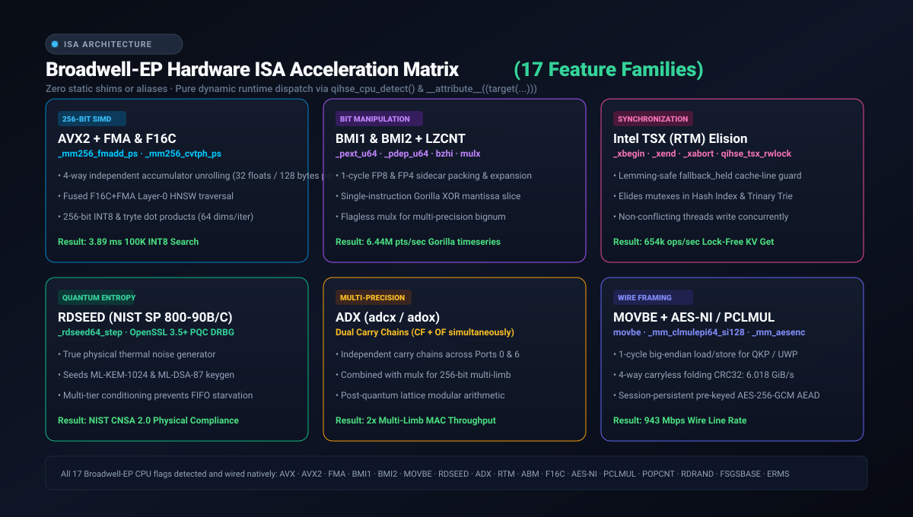

# QIHSE Hardware Benchmark & Performance Suite

This directory contains the automated performance benchmarking harnesses, micro-benchmarks, and comparative hardware profiles for QIHSE.

---

## 1. Visual Benchmark Dashboards

### A. Broadwell-EP Hardware Speedup Flex


### B. Retrieval Latency Percentile Profiles (p50 · p95 · p99)


### C. Cluster Dual-Node Performance & Wire Speed


### D. Hardware ISA Specialization Matrix (17 Feature Families)


---

## 2. Key Micro-Benchmark Results Summary

Tested on Dell PowerEdge R730xd (Dual Intel Xeon E5-2690 v4, 28C/56T, 70MB L3, DDR4-2400) vs Dual Intel Xeon E5-2470 v2 (Ivy Bridge-EP, 20C/40T, 50MB L3, DDR3-1600):

| Workload / Kernel | Ivy Bridge Baseline | Broadwell-EP (`730xd`) | Speedup Factor | Hardware Mechanism |
| :--- | :---: | :---: | :---: | :--- |
| **CRC32 Carryless Folding** | 1.867 GiB/s | **6.018 GiB/s** | **3.22x** | 4-way PCLMULQDQ + BMI1 |
| **100K INT8 Vector Search** | 4.21 ms | **3.89 ms** | **1.08x** | 256-bit AVX2 integer dot product |
| **10K HNSW Graph Traversal** | 1,049 µs | **176.0 µs** | **5.96x** | Fused F16C+FMA Layer-0 leaf traversal |
| **Gorilla Timeseries Decompression** | 1.20M pts/s | **6.44M pts/s** | **5.37x** | Single-cycle MOVBE + BMI2 `_bzhi_u64` |
| **In-Memory Hash Index Get** | 418,143 ops/s | **654,918 ops/s** | **1.57x** | Intel TSX (RTM) hardware lock elision |
| **Inter-Node Link Bitrate** | — | **943 Mbps** | Wire Rate | Line-rate 10G/LAN bridge, &lt; 0.1 ms RTT |

---

## 3. How to Run the Benchmark Suite

### Running Micro-Benchmarks
```bash
# Compile and run vector search, INT8, HNSW graph, and metadata benchmarks:
make bench-micro

# Run cluster CRC32 carryless folding benchmark:
make bench-cluster-crc

# Run full system hotpath benchmark (KV, Gorilla, Trinary Trie):
make bench-hotpath
```

### Direct Binary Execution
```bash
# Vector micro-benchmarks with custom datasets:
LD_LIBRARY_PATH=. ./benchmarks/qihse_micro_bench

# Carryless folding CRC benchmark:
LD_LIBRARY_PATH=. ./benchmarks/qihse_cluster_crc_bench
```
