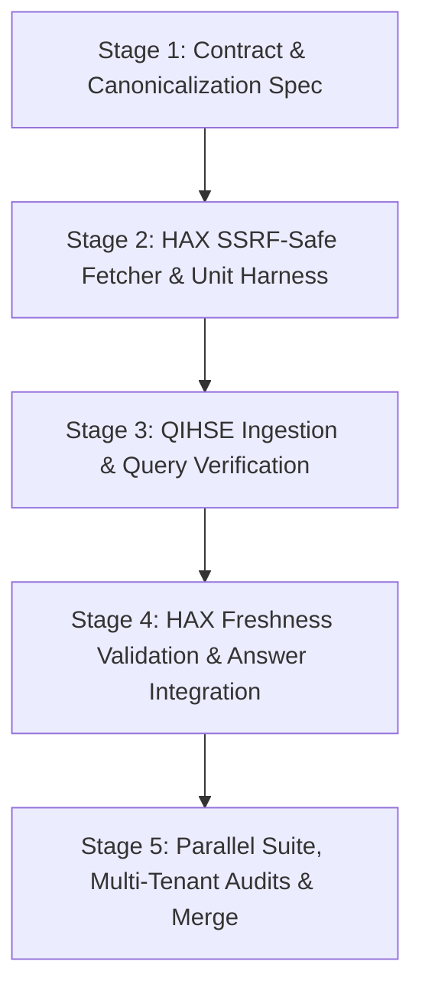

# AIMEM HTTPS URL Source Contract (QHK3)

> **Roadmap authority:** [ROADMAP.md](../../ROADMAP.md) is the sole authority for delivery status, remaining work, sequencing and acceptance. This file specifies the design, wire contract, security invariants, SSRF/DNS-rebinding defenses, freshness verification, and rollout gates for extending QH-HAX-04 document citations to external HTTPS URL sources.

Status: Design for staged implementation. This document defines the typed URL source representation, canonicalization rules, SSRF-safe retrieval requirements, QIHSE authorization invariants, HAX freshness verification, and rollout gates. It does not modify live storage formats, authorize live external writes, or contact external network services.

---

## 1. Executive Summary & Architectural Boundaries

HAX requires a durable, cryptographically verifiable connection between an extracted knowledge fact in QIHSE AIMEM and an external HTTPS web resource from which that fact was derived. Treating a memory UUID as a web citation is invalid: remote web resources are mutable, can change revision, or can be removed, making unverified citations misleading or factually incorrect.

The existing QHK3 citation tuple `(source_system, source_id, revision_id, line_start, line_end)`—originally implemented for repository file sources (`source_system = "hax-file"`)—possesses the precise structural shape required to anchor web citations without modifying the underlying QIHSE C storage structs, the QKV5 write-ahead log format, or the RESP protocol wire encoding.

### Architectural Separation of Concerns

1. **HAX (Client/Retriever/Synthesizer):**
   - Owns external network I/O, canonicalization, SSRF/DNS-rebinding defenses, redirect policy, MIME sniffing, and byte-to-text decoding.
   - Computes the immutable content revision hash (`sha256:<lowercase_hex>`) over exact wire bytes upon initial ingestion.
   - Re-validates citation freshness at answer synthesis time via conditional re-fetch or cached proof.
   - Withholds stale, changed, or unreachable citations from user answers.

2. **QIHSE (Server/Knowledge Store/Authorization Authority):**
   - Stores immutable knowledge chains, provenance, and typed `source_ref` tuples in QHK3 format.
   - **Never makes outbound network connections.** Core QIHSE daemons and cluster bus threads remain strictly air-gapped from external HTTP/HTTPS services.
   - Enforces multi-tenant isolation, mandatory security context (`qihse_user_t *`), classification dominance, and SCI compartment validation across all create, get, query, walk, and export paths.
   - Evaluates exact `source_ref` query filters before ranking, candidate selection, or BM25/hybrid scoring.

---

## 2. QHK3 Typed Tuple Specification for HTTPS URLs

In QIHSE AIMEM, external source citations are represented by `qihse_ai_memory_source_ref_t` (defined in `include/qihse_ai_memory.h`):

```c
#define QIHSE_AIMEM_SOURCE_SYSTEM_MAX 32u
#define QIHSE_AIMEM_SOURCE_ID_MAX 256u
#define QIHSE_AIMEM_SOURCE_REVISION_MAX 128u

typedef struct {
    char system[QIHSE_AIMEM_SOURCE_SYSTEM_MAX + 1u];
    char id[QIHSE_AIMEM_SOURCE_ID_MAX + 1u];
    char revision[QIHSE_AIMEM_SOURCE_REVISION_MAX + 1u];
    uint32_t line_start; /* 1-based, inclusive */
    uint32_t line_end;   /* 1-based, inclusive */
} qihse_ai_memory_source_ref_t;
```

For web sources, the fields map to the following strict typed invariants:

| Field | Type & Bounds | Proposed Wire Value | Semantics |
| --- | --- | --- | --- |
| `source_system` | `char[33]`, max 32 chars | `"https-url"` | Fixed ASCII identifier (9 chars). Distinguishes web resources from `"hax-file"` and other source providers. |
| `source_id` | `char[257]`, max 256 chars | `https://<canonical-host>/<canonical-path>[?<query>]` | Fully qualified, RFC 3986 canonicalized HTTPS URL. ASCII/Punycode. Never an IP literal, local file path, or relative URL. |
| `revision_id` | `char[129]`, max 128 chars | `sha256:<64 lowercase hex digits>` | SHA-256 cryptographic digest (71 chars total) computed strictly over the *exact raw wire bytes* received in the HTTP response body. |
| `line_start` | `uint32_t` (1-based, inclusive) | Integer `>= 1` | Starting line number within the normalized decoded UTF-8 text representation. |
| `line_end` | `uint32_t` (1-based, inclusive) | Integer `>= line_start` | Ending line number within the normalized decoded UTF-8 text representation. |

### Field Invariants

1. `line_start` and `line_end` must satisfy `1 <= line_start <= line_end`. Single-line citations have `line_start == line_end`.
2. All strings must be valid ASCII within character range `32 <= c <= 126` (no control characters, CR, LF, TAB, or DEL).
3. The canonical URL must strictly fit within 256 bytes (`QIHSE_AIMEM_SOURCE_ID_MAX`). URLs exceeding 256 bytes after canonicalization cannot be accommodated in QHK3 and are rejected at input validation.
4. The revision identifier must strictly match the regex `^sha256:[0-9a-f]{64}$`. Uppercase hex characters are invalid.

---

## 3. URL Canonicalization Specification

To ensure deterministic citation identity and prevent cache fragmentation or aliasing attacks, HAX must canonicalize all URLs according to RFC 3986 prior to ingestion or citation lookup.

### Normalization Rules

1. **Scheme Normalization:**
   - Must be strictly lowercase `https`.
   - Any non-HTTPS scheme (`http:`, `ftp:`, `file:`, `data:`, `javascript:`, `blob:`, `gopher:`) must fail validation immediately.
2. **Host Normalization:**
   - Hostnames converted to lowercase.
   - Internationalized Domain Names (IDNs) must be converted to ASCII compatible encoding (Punycode / RFC 5891) prior to length checking and hashing.
   - Trailing dots are stripped: `example.com.` -> `example.com`.
   - **IP Literal Prohibition:** Raw IP literals—whether IPv4 dotted-quads (`192.0.2.1`), alternative integer/octal/hex formats (`2130706433`, `0177.0.0.1`, `0x7f000001`), or IPv6 bracketed literals (`[::1]`, `[2001:db8::1]`)—are strictly forbidden as canonical `source_id` hosts. Web citations must anchor to registered domain names.
3. **Port Normalization:**
   - Default port `443` must be omitted: `https://example.com:443/doc` -> `https://example.com/doc`.
   - Non-standard ports (e.g., `:8443`, `:4433`, `:8080`) are rejected by policy to prevent SSRF port scanning.
4. **Userinfo Removal / Prohibition:**
   - URLs containing user credentials (`user:password@host` or `user@host`) are strictly forbidden and must fail validation.
5. **Path Normalization:**
   - Empty path is normalized to `/`: `https://example.com` -> `https://example.com/`.
   - Dot-segments (`.` and `..`) are removed per RFC 3986 Section 5.2.4.
   - Consecutive adjacent slashes are collapsed into a single slash: `/docs//api///item` -> `/docs/api/item` (preserving `https://`).
   - Percent-encoding normalization: Unreserved characters (`[A-Za-z0-9_.~-]`) must be decoded. Reserved characters must use uppercase hexadecimal digits (e.g., `%2F`, not `%2f`).
6. **Query Normalization:**
   - Query parameters must be sorted lexicographically by parameter name.
   - Known tracking and non-semantic parameters (e.g., `utm_*`, `fbclid`, `gclid`) should be stripped during ingestion.
   - Trailing empty query string (`?` with no parameters) is stripped.
7. **Fragment Identifier Removal:**
   - Fragment identifiers (`#section`) are client-side anchors that are never transmitted to origin servers in HTTP request lines.
   - Fragments must be stripped entirely before computing `source_id`. Line-range targeting is governed solely by `line_start` and `line_end`.
8. **Length Ceiling:**
   - If the canonical URL exceeds 256 bytes, HAX must reject the URL as a citation target.

---

## 4. SSRF and DNS Rebinding Defenses (HAX Fetcher Requirements)

Because HAX fetches external web content on behalf of users or automated indexing workflows, the fetcher is a high-risk network boundary. It must strictly enforce anti-SSRF and anti-DNS-rebinding controls.

### Fetch Isolation Architecture

- **Air-Gapped QIHSE:** Network fetch logic resides exclusively in dedicated HAX worker processes. The QIHSE C core does not link against libcurl, sockets, or HTTP client libraries.
- **Dedicated Egress Interface / Network Namespace:** In production deployments, HAX fetchers execute in an isolated network namespace with firewall rules that block egress to private address spaces.

### Pre-Fetch DNS Resolution & Prohibited Address Ranges

Before opening any TCP connection, the HAX fetcher must resolve the domain name using an explicit system resolver call and evaluate all returned IP addresses. If **any** returned IP address falls within the following ranges, the request is aborted immediately:

| IP Block | Allocation / Scope | Defense Justification |
| --- | --- | --- |
| `0.0.0.0/8` | "This" Network (RFC 1122) | Local host alias |
| `10.0.0.0/8` | Private-Use (RFC 1918) | Internal infrastructure |
| `100.64.0.0/10` | Shared Address Space (RFC 6598) | Carrier-grade NAT |
| `127.0.0.0/8` | Loopback (RFC 1122) | Local machine services (QIHSE, Redis, etc.) |
| `169.254.0.0/16` | Link-Local (RFC 3927) | AWS, GCP, Azure instance metadata (`169.254.169.254`) |
| `172.16.0.0/12` | Private-Use (RFC 1918) | Internal infrastructure |
| `192.0.0.0/24` | IETF Protocol Assignments (RFC 6890) | Protocol routing |
| `192.0.2.0/24` | Documentation / TEST-NET-1 (RFC 5737) | Non-routable test range |
| `192.88.99.0/24` | 6to4 Relay Anycast (RFC 7526) | Deprecated anycast |
| `192.168.0.0/16` | Private-Use (RFC 1918) | Internal lab / home infrastructure |
| `198.18.0.0/15` | Benchmarking (RFC 2544) | Network benchmark testing |
| `198.51.100.0/24` | Documentation / TEST-NET-2 (RFC 5737) | Non-routable test range |
| `203.0.113.0/24` | Documentation / TEST-NET-3 (RFC 5737) | Non-routable test range |
| `224.0.0.0/4` | Multicast (RFC 5771) | Multicast groups |
| `240.0.0.0/4` | Reserved for Future Use (RFC 1112) | Non-routable experimental |
| `255.255.255.255/32` | Limited Broadcast (RFC 919) | Broadcast |
| `::1/128` | IPv6 Loopback (RFC 4291) | Local machine services |
| `::/128` | IPv6 Unspecified (RFC 4291) | Unspecified target |
| `::ffff:0:0/96` | IPv4-Mapped IPv6 (RFC 4291) | Bypass wrapper for IPv4 loopback/private |
| `100::/64` | Discard-Only Address Block (RFC 6666) | Routing discard |
| `2001:db8::/32` | IPv6 Documentation (RFC 3849) | Non-routable documentation |
| `2002::/16` | 6to4 prefix (RFC 3056) | Unencapsulated relay |
| `fc00::/7` | Unique Local Address / ULA (RFC 4193) | Private IPv6 networks |
| `fe80::/10` | Link-Local Unicast (RFC 4291) | Local subnet / cloud metadata |
| `ff00::/8` | IPv6 Multicast (RFC 4291) | Multicast |

In addition, hostnames resolving to cloud metadata endpoints (`metadata.google.internal`, `instance-data`, etc.) are blocked by static name pattern.

### Anti-Rebinding: Pin-to-Socket Architecture

Standard HTTP client libraries can be vulnerable to DNS rebinding if they resolve DNS during validation and then re-resolve DNS during the connection phase. A malicious DNS server can return a benign public IP on query 1, and return `127.0.0.1` on query 2 (with TTL 0).

To make DNS rebinding structurally impossible, the HAX fetcher must implement **Pin-to-Socket**:
1. Resolve the domain name to a list of IP addresses.
2. Filter the addresses through the SSRF blocklist. Select the first valid public IP.
3. Open a low-level TCP socket directly to the selected IP on port 443.
4. Upgrade the established socket to TLS:
   - Provide the canonical hostname in the TLS SNI (Server Name Indication) extension.
   - Verify the server certificate chain against trusted system CA certificates matching the canonical hostname.
5. Send the HTTP/1.1 or HTTP/2 request over this pinned TLS connection with `Host: <canonical-host>`.
6. Under no circumstances may the client library re-resolve the hostname or open a new socket to an unvalidated address.

---

## 5. Redirect Policy

Remote web servers frequently respond with HTTP 301, 302, 307, or 308 redirects. A redirect can be used by an attacker to bypass SSRF validation (e.g., initial public URL redirects to `http://169.254.169.254/`).

### Redirect Constraints

1. **Hop Count:** Maximum of 3 redirects. If a 4th redirect is received, terminate with a `REDIRECT_LIMIT_EXCEEDED` error.
2. **Strict HTTPS Scheme Enforcement:**
   - Every redirect target must use the `https://` scheme.
   - Any attempt to redirect to `http://` or other non-HTTPS schemes must immediately terminate with `INSECURE_REDIRECT_DISALLOWED`. Protocol downgrade is never permitted.
3. **Per-Hop Canonicalization & SSRF Re-validation:**
   - The redirect target URL must undergo full RFC 3986 canonicalization.
   - The target hostname must undergo full DNS pre-resolution and IP blocklist checking.
   - The connection to the redirect target must use a newly pinned socket following the anti-rebinding flow.
4. **Header Sanitization:**
   - If a redirect crosses origins (different host or port), strip sensitive request headers (`Authorization`, `Cookie`, custom API tokens).
5. **Canonical Source Identity Binding:**
   - The final landing URL (after all redirects have been resolved) is the canonical URL stored in the QHK3 `source_id`.
   - If an initial URL `https://short.example/abc` redirects to `https://docs.example.com/spec`, the recorded `source_id` is `https://docs.example.com/spec`.
   - Provenance records in HAX can optionally record the initial redirect request URL, but the cryptographic `revision` hash binds strictly to the bytes delivered by the final landing URL.

---

## 6. Content Type, Size, and Time Limits

To prevent resource exhaustion, denial of service, and arbitrary binary ingestion, strict bounds are applied to fetched content.

### MIME Type Allowlist

Only textual, human-readable web content may be cited:
- `text/plain`
- `text/markdown`
- `text/html`
- `application/xhtml+xml`

All other media types are rejected:
- Binary executables (`application/octet-stream`, ELF, PE, Mach-O).
- Compressed archives (`application/zip`, `application/gzip`, `application/x-tar`).
- Audio/video/image media (`image/*`, `video/*`, `audio/*`).
- Complex binary document formats (`application/pdf`, `application/msword`) must use the dedicated multimodal blob storage contract (`aimem_multimodal_source_contract.md`), not the lightweight QHK3 text URL contract.

### Content Sniffing Guard

Do not trust `Content-Type` headers blindly. Upon receiving the initial 512 bytes of the payload, HAX must inspect the magic bytes:
- Reject payloads starting with `\x7fELF`, `MZ`, `\x1f\x8b`, `PK\x03\x04`, `\xca\xfe\xba\xbe`, or other known binary signatures, even if served as `text/plain`.

### Streaming Size Limit

- **Maximum Body Size:** 2 MiB (2,097,152 bytes).
- **Enforcement:**
  - If `Content-Length` header is present and exceeds 2 MiB, abort the connection immediately before reading the body.
  - If `Content-Length` is omitted (e.g., chunked transfer encoding), track bytes received. The moment the accumulator reaches 2,097,153 bytes, terminate the socket immediately and discard buffered data. Do not buffer or hash oversized payloads.

### Timeouts & Deadlines

- DNS resolution timeout: 3.0 seconds.
- TCP connect timeout: 5.0 seconds.
- TLS handshake timeout: 5.0 seconds.
- Socket read inactivity timeout: 5.0 seconds per read.
- **Total Request Deadline:** 15.0 seconds hard ceiling from the initiation of DNS resolution to complete reception of response bytes.

---

## 7. Exact Byte versus Decoded Text Semantics

A critical design requirement is maintaining a precise separation between **exact wire bytes** (for immutable cryptographic revisioning) and **decoded text lines** (for human citation and line-range targeting).

```
[ Origin Server ]
       │
       ▼ (Wire Transfer)
Raw HTTP Response Body (gzipped / deflate / identity)
       │
       ├──────────────────────────────────────────┐
       ▼                                          ▼
[ Decompressed Wire Bytes ]               [ Character Decoding ]
       │                                  (UTF-8 / detected charset)
       ▼                                          │
SHA-256 Digest                                   ▼
("sha256:<hex>")                          [ Line Normalization ]
       │                                  (CRLF / CR -> \n)
       ▼                                          │
Stored in QHK3 `revision`                         ▼
                                          [ 1-Based Line Array ]
                                          Line 1: "..."
                                          Line 2: "..."
                                                  │
                                                  ▼
                                          Target Range: [line_start .. line_end]
                                          Stored in QHK3 `line_start`, `line_end`
```

### Exact Wire Bytes (`revision`)

- The revision identifier is computed as:
  $$\text{revision} = \text{"sha256:"} + \text{hex\_lower}(\text{SHA256}(\text{decompressed\_wire\_bytes}))$$
- Decompressed wire bytes: If HTTP `Content-Encoding: gzip` or `deflate` was applied in transit, HAX decompresses the transport encoding to obtain the canonical representation served by the origin, but applies **zero** character set conversion, whitespace trimming, or line-ending transformations.
- Any auditor or verification tool can perform an identical fetch and verify byte-for-byte identity against `revision`.

### Decoded Text & Line Range Coordinates (`line_start`, `line_end`)

- **Character Decoding:**
  - Decode bytes to Unicode using the charset specified in `Content-Type` (defaulting to UTF-8).
  - Malformed or invalid character sequences must either be cleanly rejected or replaced with Unicode Replacement Character `\uFFFD`. If decoding encounters fatal errors, ingestion is aborted.
- **Line Ending Normalization:**
  - Windows CRLF (`\r\n`) and old Macintosh CR (`\r`) must be normalized to standard Unix LF (`\n`).
- **Line Numbering Semantics:**
  - Line numbers are 1-based, inclusive integers.
  - Line 1 is the first line of the normalized decoded text.
  - A citation covering lines 15 through 25 sets `line_start = 15` and `line_end = 25`.
- **HTML vs Plain Text Extraction:**
  - For `text/plain` and `text/markdown`, line numbers map directly to the normalized source document lines.
  - For `text/html`, line numbers must point to the normalized source text of the fetched HTML document (or, if HAX extracts markdown before chunking, the citation must reference the exact normalized extractor text stored in HAX's verified excerpt). To guarantee independent auditability against external origins, **line coordinates reference the normalized UTF-8 decoded source lines of the fetched web document**.

---

## 8. QIHSE Create, Get, and Query Authorization and Hash Checks

All QIHSE data structures and APIs preserve security invariants as specified in `AGENTS.md`.

### Security Invariant 1: Mandatory Security Context

Every QIHSE function capable of reading, querying, creating, or exporting knowledge records requires an explicit, authenticated `qihse_user_t *`. `NULL` context fails closed immediately and is never an authorization bypass.

```c
/* Ingestion / Mutation */
qihse_aimem_write_result_t qihse_ai_memory_knowledge_create_ex(
    qihse_resp_server_t* server,
    qihse_user_t* user,
    const qihse_ai_memory_scope_t* scope,
    uint32_t type,
    uint32_t status,
    const char* content,
    const qihse_ai_memory_knowledge_provenance_t* provenance,
    qihse_ai_memory_knowledge_version_t* out);

/* Direct Lookup */
bool qihse_ai_memory_knowledge_get(
    qihse_resp_server_t* server,
    qihse_user_t* user,
    const char* version_id,
    const qihse_ai_memory_scope_t* scope,
    qihse_ai_memory_knowledge_version_t* out);

/* Scoped Query */
qihse_ai_memory_query_snapshot_t* qihse_ai_memory_query_begin(
    qihse_resp_server_t* server,
    qihse_user_t* user,
    const qihse_ai_memory_query_v1_t* query);
```

### Authorization Enforcement

1. **Tenant Separation:** Knowledge records are partitioned by tenant. A principal in Tenant A cannot create, query, count, or verify records belonging to Tenant B, even if the URL source ID and revision hash are identical.
2. **Classification & Compartment Dominance:**
   - A knowledge record carrying classification level $L_{\text{rec}}$ and SCI compartments $C_{\text{rec}}$ is visible to principal $U$ if and only if:
     $$\text{Clearance}(U) \ge L_{\text{rec}} \quad \land \quad C_{\text{rec}} \subseteq \text{SCI\_Tokens}(U)$$
   - If authorization fails, the record is omitted completely from search results, BM25 counts, relation walks, and direct-ID lookups. No metadata, title, score, or URL is disclosed.
3. **Write Authority (Invariant 2):**
   - A principal cannot create knowledge records above its own clearance or outside its own SCI compartments.
   - Non-operator principals cannot self-approve knowledge versions (`status = QIHSE_AIMEM_KNOWLEDGE_APPROVED` requires Operator review).

### Server-Side QHK3 Ingestion Validation

When `qihse_ai_memory_knowledge_create_ex()` is invoked with a `provenance->source_ref` where `system == "https-url"`:
1. `aimem_source_ref_valid()` validates:
   - `strcmp(source->system, "https-url") == 0`
   - `strncmp(source->id, "https://", 8) == 0`
   - `strlen(source->id) <= QIHSE_AIMEM_SOURCE_ID_MAX` (256)
   - `strncmp(source->revision, "sha256:", 7) == 0`
   - `strlen(source->revision) == 71` (7 prefix + 64 hex characters)
   - `1 <= source->line_start && source->line_start <= source->line_end`
   - Characters in `system`, `id`, and `revision` are strictly within `[32..126]` (no delimiters or control characters).
2. If validation fails, QIHSE rejects the write with `QIHSE_AIMEM_WRITE_INVALID` and writes zero bytes to durable storage.

### Server-Side Exact Query Filtering

When `qihse_ai_memory_query_v1_t` includes a `source_ref` filter:
```c
static bool aimem_source_ref_equal(const qihse_ai_memory_source_ref_t* a,
                                   const qihse_ai_memory_source_ref_t* b) {
    return strcmp(a->system, b->system) == 0 &&
           strcmp(a->id, b->id) == 0 &&
           strcmp(a->revision, b->revision) == 0 &&
           a->line_start == b->line_start &&
           a->line_end == b->line_end;
}
```
The query engine filters candidates using `aimem_source_ref_equal()` **prior** to BM25 scoring or ranking. Queries with a mismatched revision or line range yield zero hits.

---

## 9. HAX Refetch, Freshness Validation, and Answer Assembly

Under the QH-HAX-04 contract, a cited document revision is never assumed to be live. Web documents change frequently. Therefore, HAX must perform active freshness validation before generating an answer containing a web citation.

```
       [ HAX Answer Assembly ]
                 │
                 ▼
  Retrieve candidate AIMEM record
  (source_system = "https-url")
                 │
                 ▼
    Freshness Cache Lookup
   (Tenant-isolated, TTL <= 300s)
     ├── Hit (hash matches) ──────────────┐
     └── Miss / Expired                   │
                 │                        │
                 ▼                        │
    Perform SSRF-safe HTTPS Fetch         │
    of canonical `source_id`              │
                 │                        │
                 ▼                        │
    Compute SHA-256 over wire bytes       │
                 │                        │
                 ▼                        │
    Compare with QHK3 `revision`          │
                 │                        │
         ┌───────┴───────┐                │
         │               │                │
       Match          Mismatch            │
         │               │                │
         ▼               ▼                ▼
   [ Valid Citation ]  [ STALE ]    [ Valid Citation ]
   - Extract lines     - Withhold   - Extract lines
     line_start..end     citation     line_start..end
   - Render excerpt    - Omit link  - Render excerpt
   - Include URL       - Flag for   - Include URL
     citation in         optional     citation in
     answer              re-ingest    answer
```

### Step-by-Step Validation Protocol

1. **Candidate Retrieval:** HAX retrieves an authorized AIMEM knowledge version via `qihse_ai_memory_query_begin()`.
2. **Citation Detection:** HAX inspects `version.source_ref`. If `system == "https-url"`:
3. **Freshness Verification:**
   - **Local Cache Check:** Check a tenant-isolated, in-memory cache of recently verified URLs. If a record exists with matching `(canonical_url, sha256_hash)` within its TTL (default 300 seconds), verification succeeds immediately.
   - **Network Re-fetch:** If not cached, HAX executes an SSRF-safe fetch of `source_id` using the anti-rebinding client.
   - **Conditional Fetch (Optional Optimization):** If the origin returned an `ETag` during prior ingestion, HAX may issue a conditional `If-None-Match: <etag>` request. However, a `304 Not Modified` is accepted *only* if HAX has cached proof that this specific `ETag` produced the identical `sha256:<hex>` wire revision.
   - **Digest Calculation:** Compute SHA-256 over the newly received wire bytes.
4. **Resolution Outcomes:**
   - **FRESH (Digest Matches):** The computed digest matches `source_ref.revision`. HAX decodes the text, normalizes line endings, extracts lines `[line_start .. line_end]`, and renders the verified excerpt and citation link in the synthesized answer.
   - **STALE (Digest Mismatch):** The remote document has changed. The citation is marked `STALE`. HAX **must not** render the excerpt or citation link as current evidence. HAX may trigger an asynchronous background task to propose an updated knowledge version, but never silently rewrites the citation under the old identity.
   - **UNAVAILABLE (HTTP 4xx/5xx, Timeout, SSRF Block):** The remote document is unreachable. HAX marks the citation `UNAVAILABLE` and suppresses the citation from the user response.

---

## 10. Compatibility & Storage Durability

### Zero C Struct Changes

The proposed `"https-url"` contract is 100% binary- and layout-compatible with existing QIHSE components:
- `QIHSE_AIMEM_SOURCE_SYSTEM_MAX` is 32. `"https-url"` requires 9 bytes + 1 null terminator = 10 bytes.
- `QIHSE_AIMEM_SOURCE_ID_MAX` is 256. Canonical HTTPS URLs up to 256 bytes fit without buffer alterations.
- `QIHSE_AIMEM_SOURCE_REVISION_MAX` is 128. `"sha256:<64 hex>"` requires 71 bytes + 1 null terminator = 72 bytes.
- `line_start` and `line_end` are standard 32-bit unsigned integers.

### Wire Format & Delimiter Safety

In `src/spinnaker/qihse_ai_memory.c`, QHK3 encodes `source_ref` using hex-encoded string fields:
```c
APPEND("|1|%s|%s|%s|%u|%u", system_hex, id_hex, revision_hex,
       v->source_ref.line_start, v->source_ref.line_end);
```
Because the canonical URL string is hex-encoded during serialization:
- Characters such as `|`, `:`, `/`, `?`, `=`, `&`, and `%` in the URL cannot collide with pipe (`|`) field separators.
- Backward compatibility: Existing QHK2 records (which lack source citations) and existing QHK3 records citing `"hax-file"` parse cleanly without format migration.

### Export, Backup, and Replication Durability

- QKV5 write-ahead logs, durable SSTables, and crash recovery routines store `qihse_ai_memory_source_ref_t` as part of the immutable knowledge chain blob.
- Replication across cluster nodes via `qihse_federation_repl.c` transmits QHK3 records verbatim. No protocol version bump is required.

---

## 11. Required Negative Authorization and Security Tests

Per QIHSE Security Invariant 3 (`AGENTS.md`), any new data access or adapter surface must be validated by automated negative authorization and security tests in CI prior to merge.

### 1. Mandatory QIHSE Multi-Tenant and Clearance Tests

| Test Case | Setup | Action | Expected Denial Behavior |
| --- | --- | --- | --- |
| **Low-Clearance Query Denial** | Store knowledge record citing `https-url` with classification `SECRET`. | Principal with `UNCLASSIFIED` clearance issues BM25 query matching URL keywords. | Returns 0 hits. No score, title, text, or URL disclosed. |
| **Missing SCI Compartment** | Store knowledge record citing `https-url` with SCI token `TK_GAMMA`. | Principal with `TOP SECRET` clearance but missing `TK_GAMMA` queries knowledge. | Returns 0 hits. Completely filtered before candidate ranking. |
| **Cross-Tenant Isolation** | Tenant A stores record with `id = "https://example.com/spec"`. | Tenant B queries exact `source_ref` with identical URL and revision. | Returns 0 hits. No existence or collision signal disclosed. |
| **Unauthenticated / NULL Context** | Call `qihse_ai_memory_knowledge_get` or `query_begin` with `user = NULL`. | Invoke API. | Immediate assertion failure or crash-safe denial. Zero bytes returned. |
| **Non-Operator Approval Block** | Standard user principal creates version citing `https-url` with `status = APPROVED`. | Invoke `qihse_ai_memory_knowledge_create_ex`. | Write rejected with `QIHSE_AIMEM_WRITE_DENIED`. |

### 2. HAX SSRF and Network Security Test Fixtures

All SSRF tests must execute in an automated test harness using simulated loopback servers, mock DNS, and synthetic fixtures. **No live internet access is used in CI.**

| Test Case | Input URL / Scenario | Defense Mechanism Tested | Expected Result |
| --- | --- | --- | --- |
| **IPv4 Loopback** | `https://127.0.0.1/admin` | IP literal prohibition & blocklist | Rejected at URL validation phase. |
| **Decimal Loopback** | `https://2130706433/` | Host format & IP literal parser | Rejected at URL validation phase. |
| **IPv6 Loopback** | `https://[::1]/status` | IPv6 bracket & blocklist | Rejected at URL validation phase. |
| **Cloud Metadata IP** | `https://169.254.169.254/latest/meta-data/` | Link-local blocklist | Connection blocked before socket creation. |
| **GCP Metadata Host** | `https://metadata.google.internal/computeMetadata/v1/` | DNS pre-resolution & name filter | Blocked at DNS evaluation phase. |
| **RFC 1918 Private** | `https://10.20.30.40/secret`, `https://192.168.1.1/` | Private address blocklist | Blocked at DNS evaluation phase. |
| **CGNAT Address** | `https://100.64.0.1/` | RFC 6598 blocklist | Blocked at DNS evaluation phase. |
| **Non-Standard Port** | `https://example.com:22/` or `:8080/` | Port allowlist (443 only) | Rejected during canonicalization. |
| **DNS Rebinding Attack** | Mock DNS server returns `93.184.216.34` on resolution, then `127.0.0.1` on reconnect. | Pin-to-socket architecture | Socket connects strictly to the first resolved IP. Re-query prohibited. |
| **Redirect Protocol Downgrade** | `https://example.com/` redirects (302) to `http://example.com/` | Strict HTTPS redirect rule | Aborted on redirect hop 1. |
| **Redirect to Internal Host** | `https://example.com/` redirects to `https://127.0.0.1/vault` | Per-hop SSRF validation | Aborted on redirect hop 1. |
| **Redirect Limit Exceeded** | 4 successive 302 redirects | Hop ceiling (max 3) | Terminated with `REDIRECT_LIMIT_EXCEEDED`. |
| **Oversized Response** | Server streams 3 MiB of text | Streaming body cap (2 MiB) | Socket severed at 2,097,153 bytes. Payload discarded. |
| **Binary Disguised as Text** | ELF executable served with `Content-Type: text/plain` | Content sniffing / magic byte check | Initial 512-byte sniff detects `\x7fELF`. Fetch aborted. |

### 3. Ingestion and Revision Boundary Tests

| Test Case | Input Value | Expected Validation Result |
| --- | --- | --- |
| **URL Length Overflow** | Canonical URL of 257 characters | Rejected by `aimem_source_ref_valid` (`> QIHSE_AIMEM_SOURCE_ID_MAX`). |
| **Malformed Revision Hash** | `sha256:1234` (too short) or uppercase `sha256:ABCD...` | Rejected by revision format check. |
| **Unknown Hash Algorithm** | `md5:d41d8cd98f00b204e9800998ecf8427e` | Rejected by revision prefix validator. |
| **Inverted Line Numbers** | `line_start = 50, line_end = 20` | Rejected (`line_end < line_start`). |
| **Zero Line Number** | `line_start = 0, line_end = 10` | Rejected (`line_start < 1`). |
| **Control Characters in URL** | `https://example.com/\r\nHeader: injected` | Rejected by ASCII range validator (`c < 32`). |

---

## 12. Rollout Stages and Acceptance Gates

Implementation proceeds across five phased stages. Each phase must satisfy strict acceptance criteria before advancing.



### Stage 1: Contract & Specification (Current)
- Complete design document at `docs/plans/aimem_url_source_contract.md`.
- Establish exact tuple invariants, SSRF requirements, and test matrices.
- **Gate:** Peer review and alignment with `hax_document_citation_contract.md` and `ROADMAP.md`.

### Stage 2: HAX SSRF-Safe Fetcher & Unit Harness
- Implement standalone URL canonicalization and anti-rebinding fetch client within HAX Python/C tooling.
- Build simulated network test harness (mock DNS, HTTP/HTTPS redirect test fixtures, socket-level IP binding verification).
- **Gate:** 100% pass rate across the SSRF Negative Test Suite. Zero outbound connections permitted in CI.

### Stage 3: QIHSE Ingestion & Query Verification
- Verify `aimem_source_ref_valid()` and `aimem_source_ref_equal()` in `src/spinnaker/qihse_ai_memory.c` handle `system = "https-url"` correctly.
- Add unit test cases in `tests/test_aimem_qh05_08.c` exercising `https-url` provenance creation, exact QHK3 query matching, and mismatched revision filtering.
- **Gate:** Multi-tenant and clearance tests pass under `make test TEST_JOBS=32`.

### Stage 4: HAX Freshness Validation & Answer Synthesis Integration
- Integrate the freshness validation hook into the HAX answer synthesizer.
- Implement tenant-isolated freshness caching (300s TTL) and stale citation withholding.
- Prove that modified remote bytes cause the citation to be suppressed from user answers without altering QIHSE stored knowledge records.
- **Gate:** Answer assembly tests prove zero stale excerpts rendered when remote hash diverges.

### Stage 5: Full Parallel Suite & End-to-End Audit
- Run the complete QIHSE parallel test suite: `make test TEST_JOBS=32`.
- Run HAX integration test suite verifying end-to-end knowledge citation from QIHSE storage to citation display.
- Conduct audit of stack usage in cluster bus paths per `AGENTS.md` guidelines.
- **Gate:** Clean CI run with zero regressions, zero invariant violations, and zero compiler warnings.
